  

  
  
  
  

## What I build

Web and mobile products with language models built in: assistants that talk to customers, models that read photos and transcribe audio. I handle the whole system, from the app to the server, the database and the deploy.

## Featured work

| Project | What it does | Stack |
|---|---|---|
| [**Trevsi**](https://github.com/nachomorales9/trevsi-showcase) · in development | A private photo game for trips with friends | React Native · Expo · Supabase |
| [**Nodo**](https://github.com/nachomorales9/nodo-showcase) · live | AI sales assistant: Claude talks with visitors, a second model saves each lead to the CRM | Next.js · Anthropic SDK · Folk |
| [**Atlas del Sabor**](https://github.com/nachomorales9/atlas-del-sabor-showcase) · live | 172 countries, 856 traditional recipes, an AI chef and recipes from photos | Next.js · Groq · Supabase |
| [**Estúdiate**](https://github.com/nachomorales9/estudiate-showcase) · live | Study app: AI summarizes and quizzes your notes, reads photos, transcribes classes | React · Groq · Supabase |
| [**Fulbazo**](https://github.com/nachomorales9/fulbazo-showcase) · live | World Cup 2026 platform: predictions, rankings, live chat, four languages | Supabase · Clerk · Mercado Pago |

## How I use AI

- **The right model for each task:** a large one where the quality of the answer matters, a small one for extracting data.
- **Controlled outputs:** fixed schemas, limits per user and per request, and a person reviews before anything is published.
- **Claude Code with rules:** project rules, and a security review before any change to the database or authentication.

## Stack

TypeScript · React · Next.js · React Native · Expo · Supabase · PostgreSQL · Claude API · Groq · Vercel
