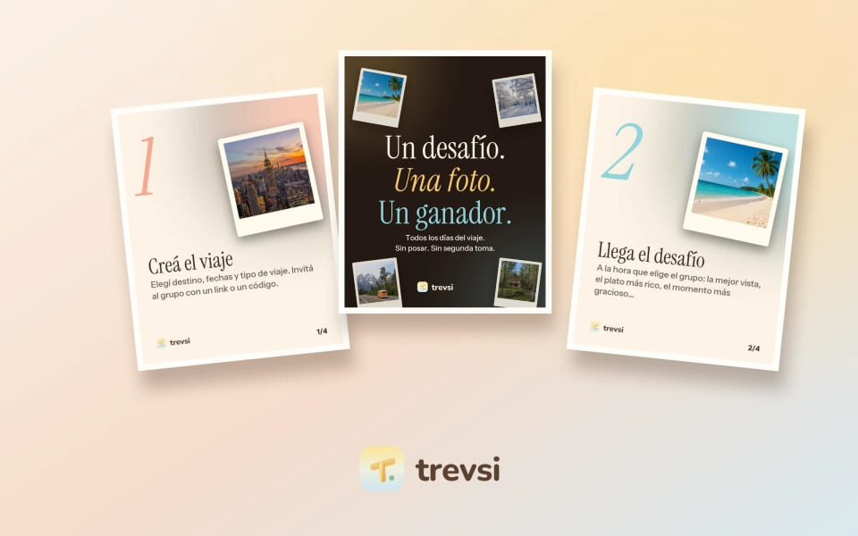
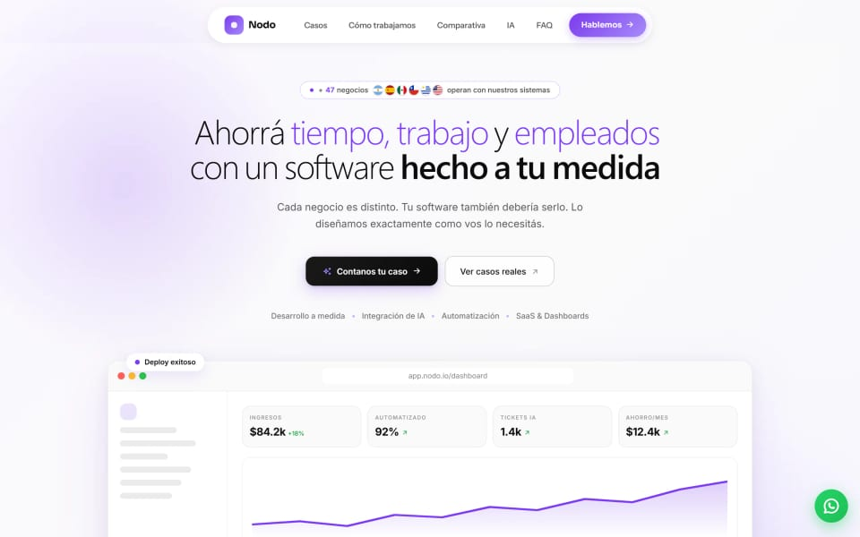
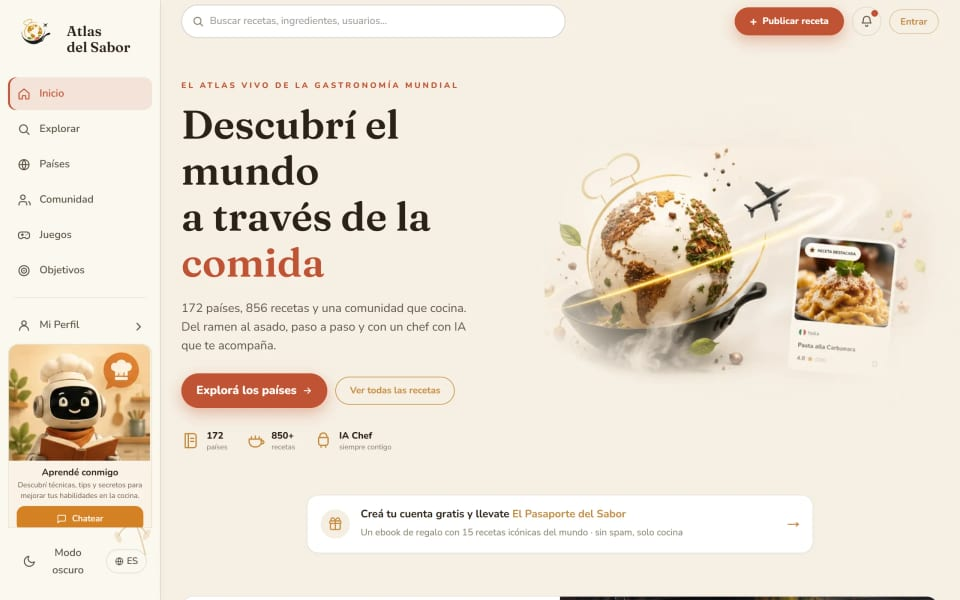
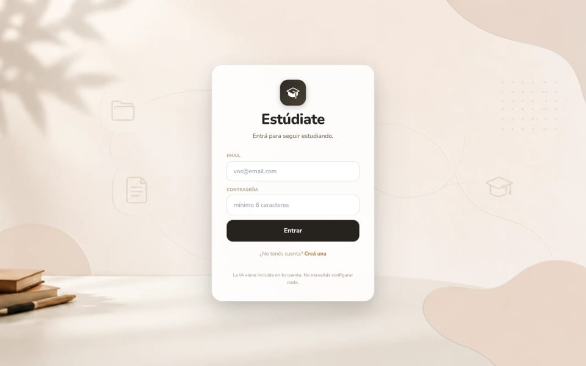
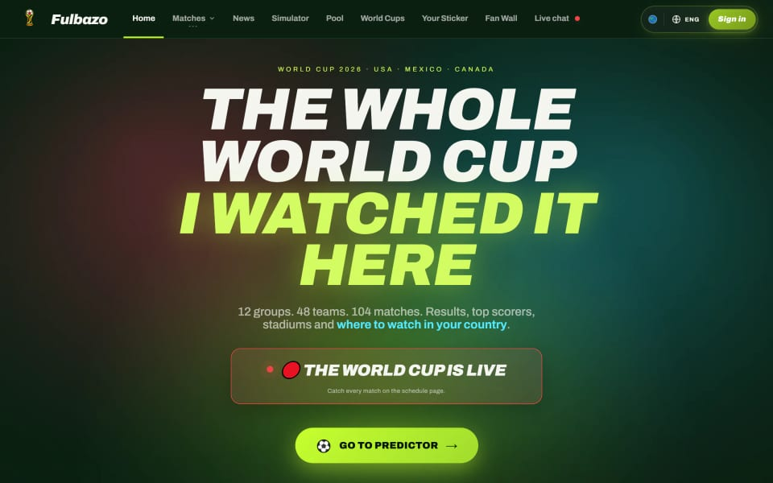

  
  
  
  

Soy **Técnico en Programación (UTN)** y vivo en Buenos Aires. Construyo productos web y móviles, y la parte de IA que llevan adentro: elijo el modelo según la tarea, le pongo límites y construyo todo lo que lo rodea, desde la app hasta el servidor, la base de datos y el deploy.

## Proyectos

<table>
  <tr>
    <td width="50%" valign="top">
      
       <b>Trevsi</b> · App móvil · 2026 (beta)
       El juego de fotos para viajar con amigos: cada día llega un desafío, cada uno sube una foto y el grupo vota la mejor.
       React Native · Expo · TypeScript · Supabase · Cloudflare R2
    </td>
    <td width="50%" valign="top">
      
       <b>Nodo</b> · Asistente comercial con IA · 2025
       Claude Sonnet 4.6 atiende al visitante y Claude Haiku 4.5 carga el lead en el CRM con structured outputs.
       Next.js · TypeScript · Anthropic SDK · Folk · Telegram
    </td>
  </tr>
  <tr>
    <td width="50%" valign="top">
      
       <b>Atlas del Sabor</b> · Recetas con IA · 2026
       856 recetas de 172 países redactadas con Llama sobre un canon curado a mano, un chef con streaming y recetas desde una foto.
       Next.js · Supabase · Groq · Zod · Upstash Redis
    </td>
    <td width="50%" valign="top">
      
       <b>Estúdiate</b> · App de estudio con IA · 2026
       Resume y pregunta sobre tus apuntes, lee fotos con Llama 4 Scout y transcribe clases con Whisper.
       React · TypeScript · Groq · Supabase · Vercel Edge
    </td>
  </tr>
  <tr>
    <td width="50%" valign="top">
      
       <b>Fulbazo</b> · Plataforma del Mundial 2026
       Prode, ranking, grupos privados, chat en vivo y estadísticas, en cuatro idiomas.
       JavaScript · Supabase · Clerk · Mercado Pago · Vercel
    </td>
    <td width="50%" valign="top">
       <b>Cada proyecto, explicado</b>
       En el <a href="https://ignaciomoralesdev.vercel.app">portfolio</a> cuento el problema, cómo lo resolví, qué hace el modelo, qué controla el código y qué decide una persona.
        <a href="https://ignaciomoralesdev.vercel.app/resumen">Ver todo en una página →</a>
    </td>
  </tr>
</table>

## Cómo trabajo con IA

- **El modelo justo para cada tarea.** Uno grande donde importa cómo responde, uno chico donde la tarea es mecánica, y ninguno donde alcanza una regla.
- **Límites desde el principio.** Respuestas con esquema fijo, la clave en el servidor, topes por persona y por respuesta, modelo de reemplazo y revisión humana antes de publicar.
- **Claude Code, usado con método.** `CLAUDE.md` y reglas por área, subagentes propios de solo lectura (arquitectura, seguridad y revisión de código), skills y plugins. La decisión final, las credenciales y los deploys son míos.
- **Probado antes de publicar.** Tests, pruebas de permisos en la base de datos y CI en cada push.

## Herramientas

## Contacto

¿Tenés un proceso que hoy se hace a mano o una idea de producto? Escribime a **[ignaciorodolfomorales@gmail.com](mailto:ignaciorodolfomorales@gmail.com)** o por **[LinkedIn](https://www.linkedin.com/in/ignaciomoralesdev)**.
